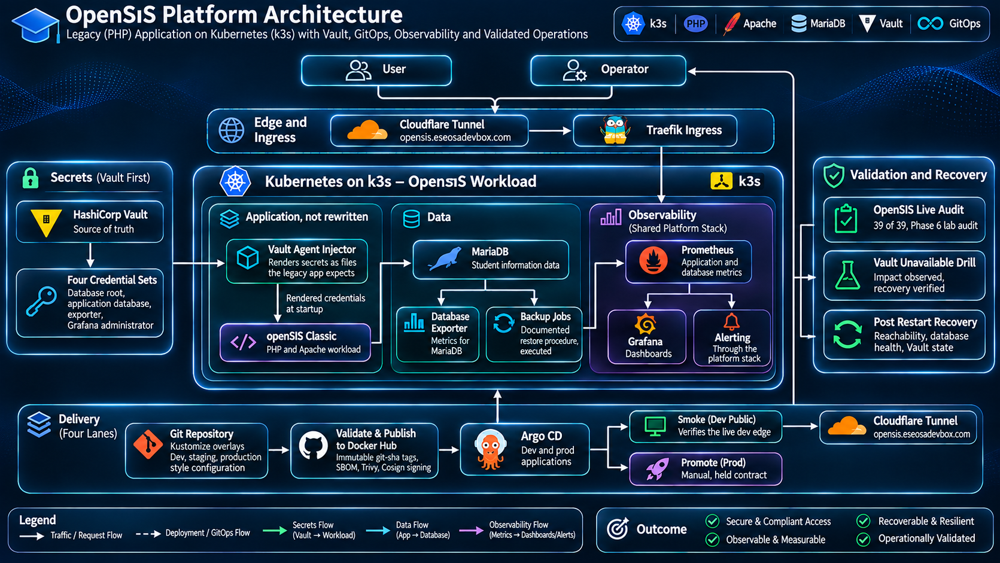
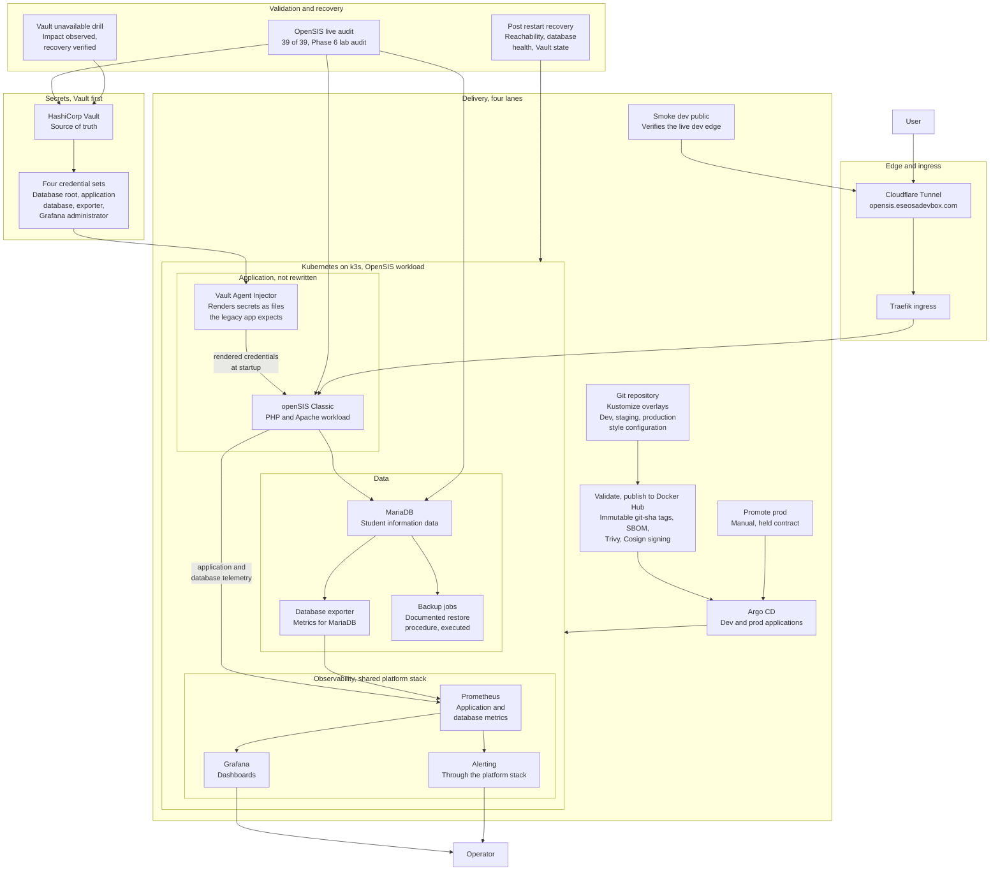
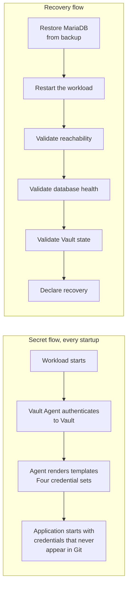

# OpenSIS Platform Architecture

This document is the architecture design of record for the Secure OpenSIS Platform: a legacy application wrapped with modern delivery, secrets, observability, and recovery, without rewriting the application. The image above is rendered from the Mermaid source in this file, so the picture and the source never drift apart. The repository's Architecture Reference (`docs/06-architecture-reference.md`) remains the deep dive for traffic flow, secrets flow, and design decisions.

## The design in one paragraph

openSIS Classic, a PHP and Apache monolith, runs on Kubernetes behind Cloudflare Tunnel and Traefik ingress. It was not rewritten. HashiCorp Vault is the secret source of truth, and the Vault Agent Injector renders four credential sets (database root password, application database password, database exporter password, Grafana administrator password) into the files the legacy application expects at startup, so credentials never appear in Git or plain manifests. MariaDB holds the data, with a database exporter feeding Prometheus, and backup jobs paired with a documented restore procedure that has been executed, not only configured. Delivery runs four lanes: validate; publish to Docker Hub with immutable git-sha tags, SBOM, Trivy, and Cosign signing; smoke verification of the public dev edge; and a manual, held prod promotion, with Argo CD applications for dev and prod. Validation is the live audit (39 of 39 checks, Phase 6 lab audit), the Vault unavailable drill, and post restart recovery verification in the order reachability, database health, Vault state. Vault is a startup dependency by design: explicit, monitored, and drilled.

## Architecture diagram, Mermaid source

## Flow diagram: secret delivery and recovery, Mermaid source

## Notes

- The application itself is the existing open source openSIS Classic. Credit for the application belongs to its authors; the engineering recorded here is the platform wrapper, secrets, delivery, observability, and recovery work.
- This is a lab environment deployment. Production style configuration is a configuration model, not a claim of production use by a school or institution.
- Live application: `https://opensis.eseosadevbox.com`.
